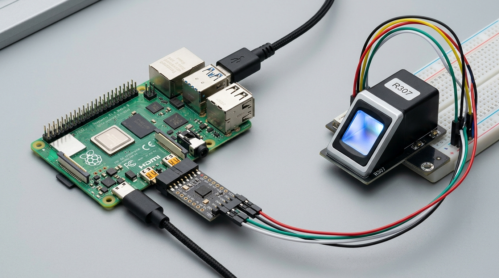
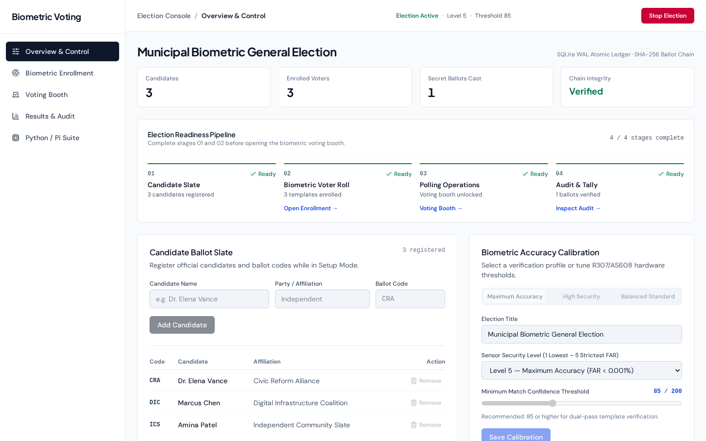
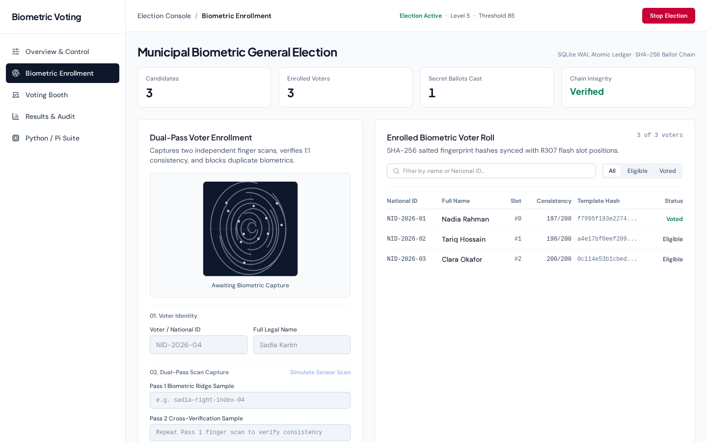
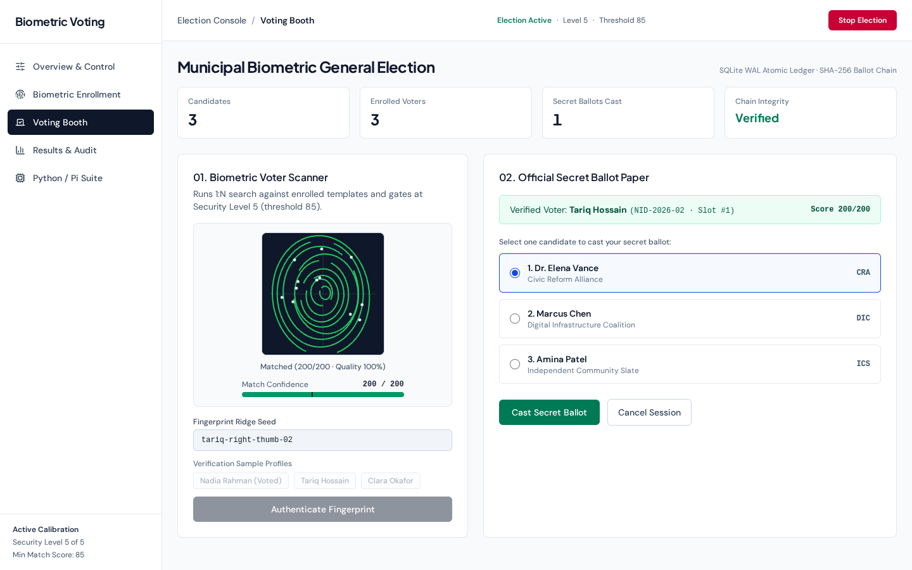
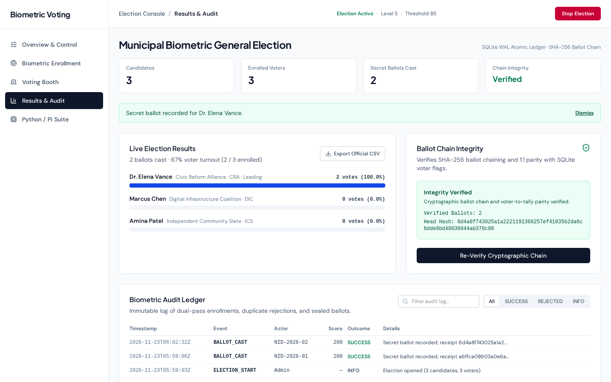
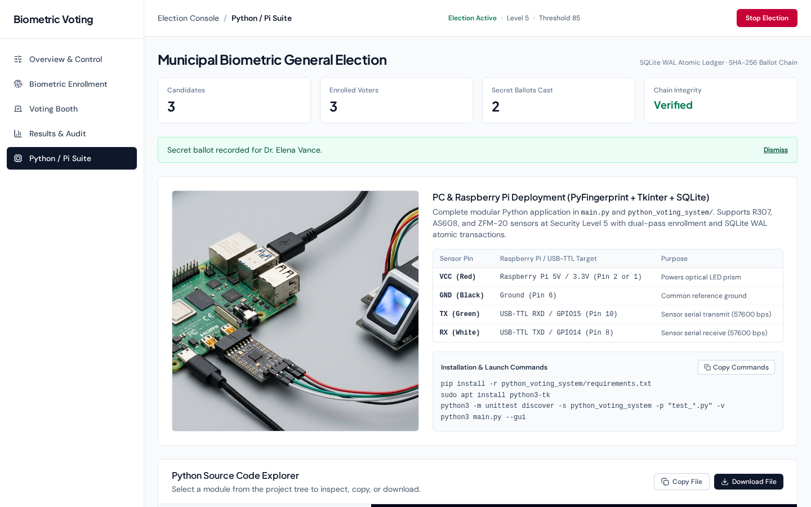

# FingerPrintVoting-System

High-accuracy biometric electronic voting platform built for **PC and Raspberry Pi** using **Python, PyFingerprint, Tkinter, and SQLite**, paired with a synchronized **SQLite-backed Web Election Console**.

---

## Hardware Architecture (Raspberry Pi + R307 / AS608 Sensor)



The Python engine (`python_voting_system/`) connects directly to **R307**, **AS608**, **ZFM-20**, or **R305** optical/capacitive fingerprint modules over USB-TTL (`/dev/ttyUSB0`, `COM*`) or Raspberry Pi UART (`/dev/ttyAMA0`, `/dev/serial0`) at `57600 bps`, and automatically falls back to a deterministic 512-byte minutiae simulator when physical hardware is not attached.

| Sensor Pin | Raspberry Pi / USB-TTL Target | Purpose |
| :--- | :--- | :--- |
| `VCC (Red)` | `5V / 3.3V (Pin 2 or Pin 1)` | Powers optical prism LED & DSP |
| `GND (Black)` | `Ground (Pin 6)` | Common reference ground |
| `TX (Green)` | `USB-TTL RXD / GPIO15 (Pin 10)` | Sensor serial transmit (`57600 bps`) |
| `RX (White)` | `USB-TTL TXD / GPIO14 (Pin 8)` | Sensor serial receive (`57600 bps`) |

---

## Visual Walkthrough & Screen Details

### 1. Overview & Control — Readiness Pipeline & Accuracy Calibration



- **Election Readiness Pipeline**: Tracks all four operational stages (`01 Candidate Slate` → `02 Biometric Voter Roll` → `03 Polling Operations` → `04 Audit & Tally`) with direct navigation shortcuts.
- **Candidate Ballot Slate**: Registers candidate names, affiliations, and ballot codes (`CRA`, `DIC`, `ICS`) while the machine is in `Setup Mode`.
- **Biometric Accuracy Calibration**: Provides preset profiles (**Maximum Accuracy Level 5 / Threshold 85**, **High Security Level 4 / Threshold 75**, **Balanced Standard Level 3 / Threshold 65**) alongside fine-grained threshold tuning and a two-step safe database reset guard.

### 2. Biometric Enrollment — Dual-Pass Template Fusion & Duplicate Guard



- **Dual-Pass Verification**: Captures Pass 1, immediately runs a **1:N duplicate check** against every enrolled template to block duplicate fingers across different National IDs, captures Pass 2, and verifies **1:1 template consistency** (`compareCharacteristics()`) before storing the fused template.
- **Enrolled Biometric Voter Roll**: Displays National ID, full name, sensor flash slot (`#0`, `#1`, `#2`), consistency score (`/200`), SHA-256 salted template hash preview, and live search + status filtering (`All` / `Eligible` / `Voted`).

### 3. Voting Booth — 1:N + 1:1 Authentication & Secret Ballot Casting



- **High-Accuracy Verification**: Executes a 1:N template search across enrolled records, enforces the active confidence threshold (`>= 85` at Security Level 5), and verifies `has_voted = 0` inside an atomic SQLite `BEGIN IMMEDIATE` transaction.
- **Secret Ballot Privacy**: Once verified, the voter selects one candidate from the **Official Secret Ballot Paper** and receives an anonymous **SHA-256 chained receipt hash** (`ballots` records do **not** store `voter_id`, preserving ballot secrecy while guaranteeing one-person, one-vote).

### 4. Results & Audit — Live Tally, Hash-Chain Integrity & Audit Ledger



- **Live Election Results**: Real-time vote counts, share percentages, voter turnout tracking, leading-candidate indicator, and one-click **Official CSV Export** (`/api/export/csv`).
- **Ballot Chain Integrity**: Independently recomputes every ballot `receipt_hash` from the genesis hash (`0000...`) and confirms 1:1 parity between `ballots` count, `candidates.vote_count` sum, and `voters.has_voted = 1` count.
- **Biometric Audit Ledger**: Filterable and searchable event log recording enrollments, duplicate biometric rejections, blocked double-vote attempts, and sealed ballots.

### 5. Python / Pi Suite — Hardware Deployment & Source Explorer



- Includes the hardware wiring specification, one-click copyable installation/launch commands, and an interactive source explorer to inspect, copy, or download every Python module (`main.py`, `biometric_sensor.py`, `database.py`, `gui_app.py`, `config.py`, `test_voting_system.py`, `requirements.txt`).

---

## Project Structure

```text
├── main.py                                # Python entry point (Tkinter GUI + CLI fallback)
├── python_voting_system/
│   ├── __init__.py
│   ├── config.py                          # Accuracy presets, serial defaults & baud rates
│   ├── biometric_sensor.py                # PyFingerprint R307/AS608 driver + 512B simulator
│   ├── database.py                        # SQLite WAL atomic transactions & SHA-256 ballot chain
│   ├── gui_app.py                         # Full 5-tab Tkinter desktop & Pi touchscreen UI
│   ├── test_voting_system.py              # Python unittest suite
│   └── requirements.txt                   # pyfingerprint, pyserial, Pillow
├── server.ts                              # Express + Vite server with SQLite REST API
├── server/
│   ├── biometricEngine.ts                 # Node SQLite biometric & cryptographic ballot engine
│   └── biometricEngine.test.ts            # Node test suite
├── src/                                   # React + Tailwind v4 web console
└── docs/images/                           # Documentation screenshots & hardware reference
```

---

## Quick Start

### Option A: Python Desktop / Raspberry Pi (PyFingerprint + Tkinter + SQLite)

```bash
pip install -r python_voting_system/requirements.txt

# On Raspberry Pi OS / Debian / Ubuntu if Tkinter is not pre-installed:
sudo apt install python3-tk

# Run Python unit & integration tests:
python3 -m unittest discover -s python_voting_system -p "test_*.py" -v

# Launch the Tkinter GUI (automatically falls back to --cli on headless terminals):
python3 main.py --gui
```

### Option B: Web Election Console (Node.js + SQLite + React)

```bash
npm install
npx --yes tsx --test server/biometricEngine.test.ts
npm run dev
```

Open `http://localhost:3000` in your browser.
